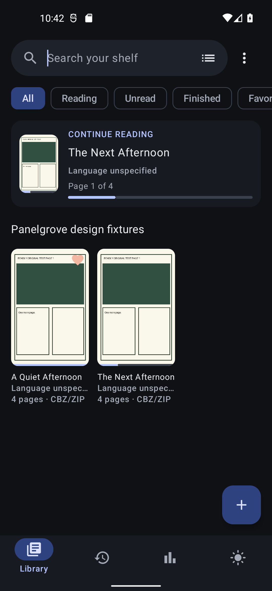
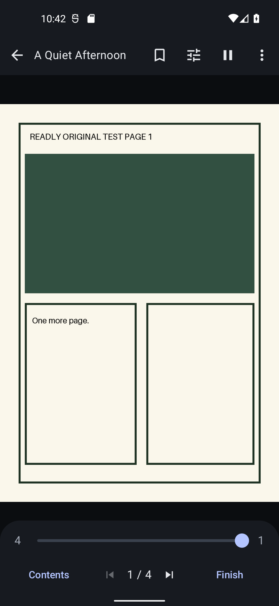
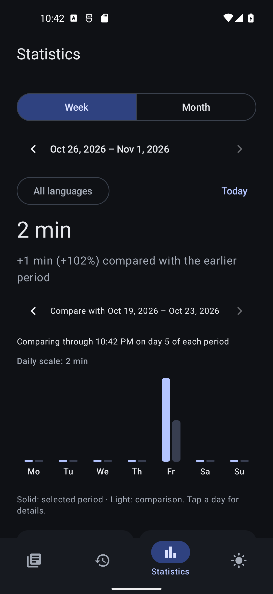
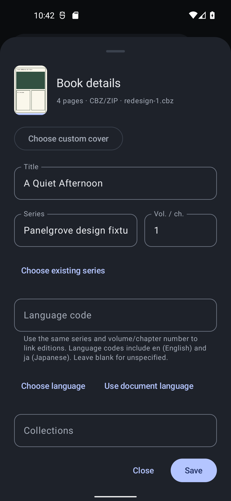
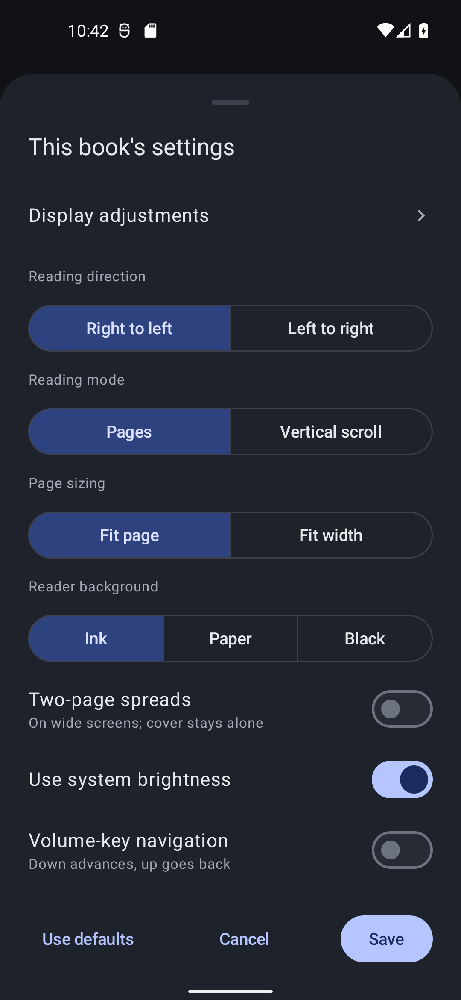
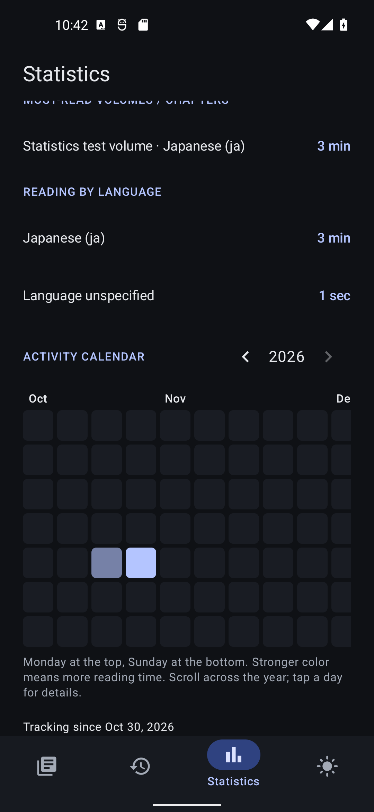
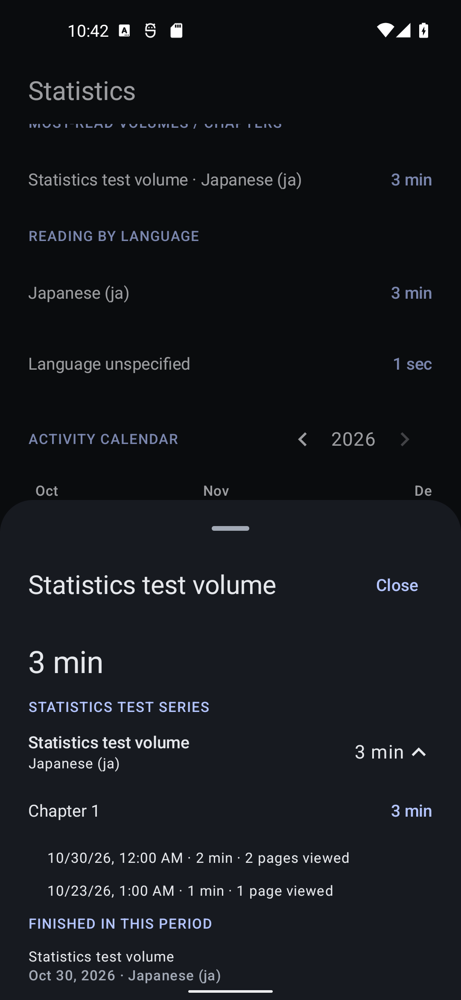
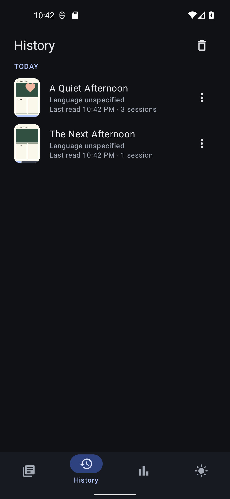
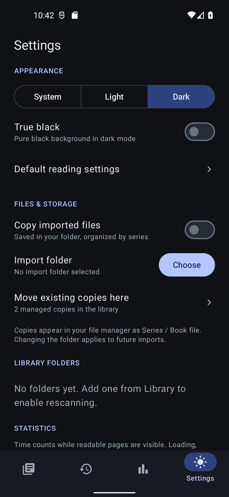

# Panelgrove

  

A free, open source manga reader for Android. Read CBZ, CBR, CB7/7Z, PDF, and image folders offline, organize language editions, and track your reading with private, on-device statistics. No ads, accounts, or analytics.

**Android 8.0+ · 1.0 stable · GPL-3.0-or-later**

[Download 1.0 APK](https://github.com/SotoOnGit/PanelGrove/releases/download/v1.0/panelgrove-v1.0.apk) · [Release notes and checksums](https://github.com/SotoOnGit/PanelGrove/releases/tag/v1.0) · [User guide](docs/USAGE.md) · [Build from source](docs/DEVELOPMENT.md) · [Report an issue](https://github.com/SotoOnGit/PanelGrove/issues)

**New in 1.0:** private reading statistics, time graphs and comparisons, chapter/session breakdowns, reading streaks and an activity calendar, all included in JSON backups. Language editions, page export, custom covers, contrast/gamma controls and CB7/7Z support are included too. See the [1.0 release notes](docs/releases/1.0.md).

## Screenshots

Explore the library, reader and reading statistics in **Panelgrove 1.0**. These screens were captured from the **1.0 / code 9 debug build** on Android 12 / API 32 with original generated demo books and statistics. [View the full gallery](docs/screenshots/README.md).

| Library | Reader | Reading statistics |
| --- | --- | --- |
|  |  |  |
| **Book details** | **Reading settings** | **Activity calendar** |
|  |  |  |
| **Chapter and session details** | **History** | **Settings** |
|  |  |  |

## Your library, on your device

- **Read your own files.** Add individual books or library folders through Android's file picker. Files stay in their original locations by default.
- **Choose how you read.** Right-to-left or left-to-right page turns, continuous vertical scrolling, landscape spreads, fit options, pinch and double-tap zoom, and volume-key navigation.
- **Pick up where you left off.** Continue reading, saved positions, bookmarks, chapter navigation, and reading history.
- **See your reading habits.** Local time graphs, pages viewed, completions, rereads, streaks, rankings, language breakdowns, sessions and a yearly activity calendar. Pause the timer or adjust its inactivity limit.
- **Organize your collection.** Search, favorites, reading-status and language filters, series, collections, editable book details, and grid or list views. Language editions share a volume/chapter stack while keeping separate reading progress.
- **Choose your covers.** Set a custom library cover without changing the source book.
- **Save or share a page.** Export full pages through Android; archive and folder images retain their original bytes, and PDF pages export as PNG.
- **Keep copies where you want them.** Optional managed copies live in a folder you choose, organized as `Series / Book file` and accessible through your file manager.
- **Make it comfortable.** Light, dark, system, and true-black appearance options, plus brightness, orientation, contrast, and gamma controls.
- **Back up your reading data.** Export and restore library organization, reading progress, bookmarks, history, reading statistics and settings as JSON.

## Supported formats

| Format | Support |
| --- | --- |
| CBZ / ZIP | PNG, JPEG, and WebP pages |
| CBR / RAR | RAR4, RAR5, and solid RAR5 archives |
| CB7 / 7Z | Solid and non-solid LZMA/LZMA2, stored, Deflate, and PPMd archives |
| PDF | Rendered with Android's PDF engine |
| Image folders | PNG, JPEG, and WebP pages in selected directory trees |

Panelgrove reads `ComicInfo.xml` and compatible `translation-manifest.json` metadata when available. Invalid optional metadata falls back to normal page ordering.

Encrypted documents, multipart archives, and EPUB are not supported. BZip2 and other unlisted 7Z compression methods are unsupported. Some RAR variants may be unsupported. Solid RAR and 7Z archives can take longer to prepare when jumping between pages because earlier compressed data must be read again. Archives retain the existing limits of 20,000 entries, 128 MiB per entry, and 8 GiB expanded in total.

## Get started

1. Download and install [Panelgrove 1.0](https://github.com/SotoOnGit/PanelGrove/releases/download/v1.0/panelgrove-v1.0.apk). The [release page](https://github.com/SotoOnGit/PanelGrove/releases/tag/v1.0) includes checksums and signing details. See the [installation guide](docs/USAGE.md#install-and-update) for Android's installation prompt and updates.
2. In **Library**, choose **Add manga → Choose files**, or add a library folder.
3. Open a book. Tap the middle of a page to show controls; tap either edge or swipe to turn pages. The default reading direction is right-to-left.

Updates are installed manually from GitHub Releases. Export a JSON backup first, then install the newer public APK over the existing app. If you used a local preview or debug build, follow the [signing-transition instructions](docs/USAGE.md#moving-from-a-local-preview-or-debug-build) before switching to the public APK.

## Files and privacy

Panelgrove works locally and requests neither internet access nor all-files access. Android's file and folder pickers control which documents it can read.

Removing a library entry leaves its external original intact. Deleting a managed copy is a separate choice. Backups contain reading data, statistics, language assignments and display settings; they exclude manga files, custom cover images and Android file-access grants. After restoring on a fresh installation, select the relevant folders again and choose custom covers again.

Panelgrove does not include manga or provide a download catalog.

## 1.0 release

Version **1.0 / code 9** is the first stable release, published on **2026-10-30** with package `dev.soto.panelgrove`. The [public release](https://github.com/SotoOnGit/PanelGrove/releases/tag/v1.0) includes the signed APK, `SHA256SUMS` and `SIGNING-CERTIFICATE.txt`.

[Build and test](https://github.com/SotoOnGit/PanelGrove/actions/runs/41132967590) passed at the tagged release commit, including JVM tests, lint, package checks and Android tests on **API 26 and 35**. The [signed release workflow](https://github.com/SotoOnGit/PanelGrove/actions/runs/41132967585) also passed. See the [release record](docs/RELEASE_1.0.md) for the verified checksum, signing identity and validation scope.

Public-signed update retention, external share receivers, broader providers/tablets, actual 16 KB execution, accessibility and sustained physical-device reading retain the limits recorded in the [validation summary](docs/VALIDATION.md#remaining-limits).

## Reading statistics

Statistics remain on the device and travel with JSON backups. Tracking starts when you install a statistics-capable version; earlier opening history cannot reconstruct past reading time. A page counts after two seconds of visible reading, and manually marking a book Read does not invent a dated finish. See the [statistics guide](docs/USAGE.md#reading-statistics) for measurement rules and the [roadmap](docs/ROADMAP.md) for the complete 1.0 scope.

## Development and feedback

Panelgrove is built with Kotlin, Jetpack Compose, Room, and Android's Storage Access Framework. The [development guide](docs/DEVELOPMENT.md) covers requirements, tests, localization, and release signing.

For a bug report, include the app version, Android version, document format, and steps to reproduce. Use generated or freely shareable samples when a sample is needed. Suggestions and pull requests are welcome through [GitHub](https://github.com/SotoOnGit/PanelGrove/issues).

## License

Panelgrove is licensed under **GPL-3.0-or-later**; see [LICENSE](LICENSE). Third-party licenses and notices are retained in [LICENSES](LICENSES/), the vendored libarchive source, and the app's notices. Generated test artwork is included under the project's license. Library books remain their owners' content.
