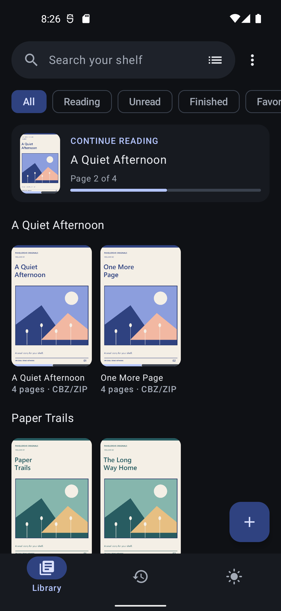
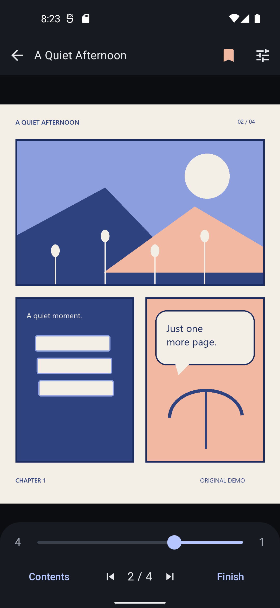
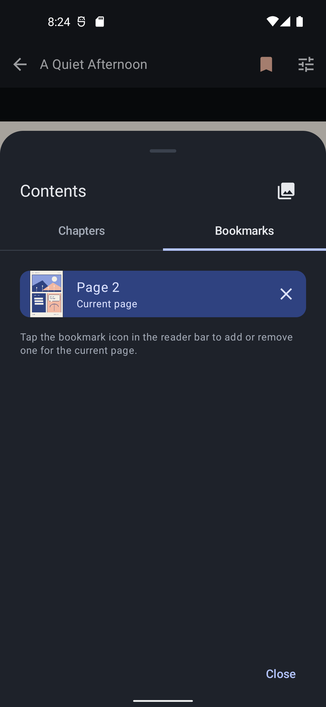
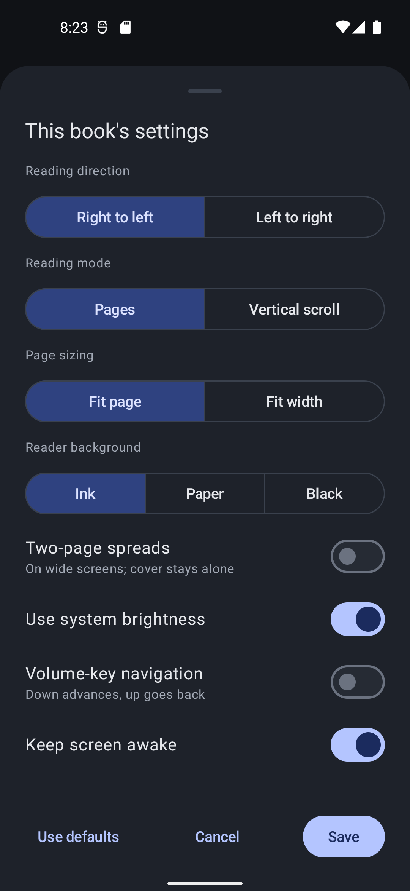
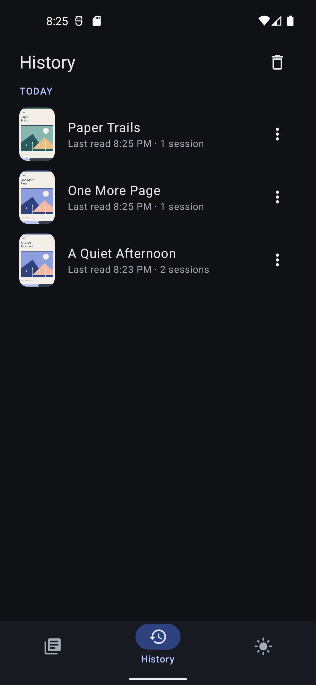
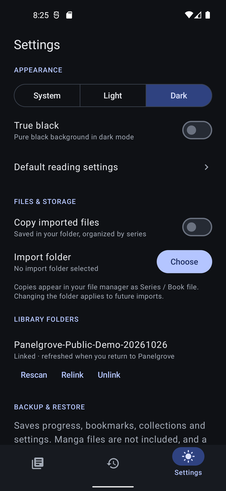

# Panelgrove

  

A free, open source manga reader for Android. Read CBZ, CBR, PDF, and image folders offline, with no ads, accounts, or analytics.

**Android 8.0+ · Prerelease 0.1.6 · GPL-3.0-or-later**

[Download APK](https://github.com/SotoOnGit/PanelGrove/releases/download/v0.1.6/panelgrove-v0.1.6.apk) · [Releases](https://github.com/SotoOnGit/PanelGrove/releases) · [User guide](docs/USAGE.md) · [Build from source](docs/DEVELOPMENT.md) · [Report an issue](https://github.com/SotoOnGit/PanelGrove/issues)

## Screenshots

Actual app screens using original demo books. [View all screenshots](docs/screenshots/README.md), including the light theme and book details.

| Library | Reader | Bookmarks |
| --- | --- | --- |
|  |  |  |
| **Reading settings** | **History** | **Settings** |
|  |  |  |

## Your library, on your device

- **Read your own files.** Add individual books or library folders through Android's file picker. Files stay in their original locations by default.
- **Choose how you read.** Right-to-left or left-to-right page turns, continuous vertical scrolling, landscape spreads, fit options, pinch and double-tap zoom, and volume-key navigation.
- **Pick up where you left off.** Continue reading, saved positions, bookmarks, chapter navigation, and reading history.
- **Organize your collection.** Search, favorites, reading-status filters, series, collections, editable book details, and grid or list views.
- **Keep copies where you want them.** Optional managed copies live in a folder you choose, organized as `Series / Book file` and accessible through your file manager.
- **Make it comfortable.** Light, dark, system, and true-black appearance options, plus brightness and orientation controls.
- **Back up your reading data.** Export and restore library organization, reading progress, bookmarks, history, and settings as JSON.

## Supported formats

| Format | Support |
| --- | --- |
| CBZ / ZIP | PNG, JPEG, and WebP pages |
| CBR / RAR | RAR4, RAR5, and solid RAR5 archives |
| PDF | Rendered with Android's PDF engine |
| Image folders | PNG, JPEG, and WebP pages in selected directory trees |

Panelgrove reads `ComicInfo.xml` and compatible `translation-manifest.json` metadata when available. Invalid optional metadata falls back to normal page ordering.

Encrypted documents, multipart archives, EPUB, and CB7/7Z are not supported. Some RAR variants may be unsupported, and sequential RAR preparation can take longer than ZIP access.

## Get started

1. Download and install [panelgrove-v0.1.6.apk](https://github.com/SotoOnGit/PanelGrove/releases/download/v0.1.6/panelgrove-v0.1.6.apk) from the [0.1.6 prerelease](https://github.com/SotoOnGit/PanelGrove/releases/tag/v0.1.6). See the [installation guide](docs/USAGE.md#install-and-update) for Android's installation prompt and updates.
2. In **Library**, choose **Add manga → Choose files**, or add a library folder.
3. Open a book. Tap the middle of a page to show controls; tap either edge or swipe to turn pages. The default reading direction is right-to-left.

Updates are installed manually from GitHub Releases. Install future public updates over the existing app to retain reading data. If you used a local preview or debug build, follow the [signing-transition instructions](docs/USAGE.md#moving-from-a-local-preview-or-debug-build) before switching to the public APK.

## Files and privacy

Panelgrove works locally and requests neither internet access nor all-files access. Android's file and folder pickers control which documents it can read.

Removing a library entry leaves its external original intact. Deleting a managed copy is a separate choice. Backups contain reading data, not manga files or Android file-access grants; after restoring, select the relevant folders again to restore access.

Panelgrove does not include manga or provide a download catalog.

## Preview status

The first public prerelease, [**0.1.6**](https://github.com/SotoOnGit/PanelGrove/releases/tag/v0.1.6), was published on **2026-10-27**. Its version code is **7** and package ID is `dev.soto.panelgrove`. The release includes the signed APK, `SHA256SUMS`, and `SIGNING-CERTIFICATE.txt`.

[GitHub CI](https://github.com/SotoOnGit/PanelGrove/actions/runs/40413500147) passed the debug build, core tests, lint, package checks, and Android tests on API 26 and 35, with 66 passed and five deliberate skips on each API. The [release workflow](https://github.com/SotoOnGit/PanelGrove/actions/runs/40491207093) also passed core tests, release lint, the signed release build, signature verification, native/ZIP alignment checks, and checksum generation.

Earlier local validation covered API 26, 32, and 36, including local-preview launches and CBZ/RAR/PDF reading. API 36 coverage spans two runs.

Physical checks on **2026-10-27** used a Xiaomi M2012K11AG running **Android 13 / API 33 (ARM64)**. The published APK reads CBZ, RAR5, PDF, and image folders through the phone's Documents picker. Fresh-install backup restoration and folder relinking preserved four books, saved positions, three bookmarks, history, and settings. Debug engine/storage checks and a separate process-restart check also passed.

All **66 applicable automated cases** have passing phone results across separate runs, including the 12 UI cases after enabling MIUI background pop-ups. The stress test first timed out at 90 and 240 seconds, then passed in 86.9 seconds with a fresh debug installation and the app foregrounded; that variability remains under investigation. Broader providers/tablets, removable SD cards, actual 16 KB execution, human accessibility review, sustained reading, and a future public-version update remain open. See the [validation summary](docs/VALIDATION.md) for the measured scope.

## Planned for 1.0

The next feature priorities, in order, are **CB7/7Z support**, **custom covers**, **contrast and gamma controls**, **language editions grouped under the same series**, **page export**, and **local reading statistics**. These are planned additions to the current prerelease. See the [roadmap](docs/ROADMAP.md) for scope and deferred features.

## Development and feedback

Panelgrove is built with Kotlin, Jetpack Compose, Room, and Android's Storage Access Framework. The [development guide](docs/DEVELOPMENT.md) covers requirements, tests, localization, and release signing.

For a bug report, include the app version, Android version, document format, and steps to reproduce. Use generated or freely shareable samples when a sample is needed. Suggestions and pull requests are welcome through [GitHub](https://github.com/SotoOnGit/PanelGrove/issues).

## License

Panelgrove is licensed under **GPL-3.0-or-later**; see [LICENSE](LICENSE). Third-party licenses and notices are retained in [LICENSES](LICENSES/), the vendored libarchive source, and the app's notices. Generated test artwork is included under the project's license. Library books remain their owners' content.
