# Panelgrove screenshots

## Version 1.0

Captured **2026-10-30** from the **1.0 / code 9 debug build** on an **Android 12 / API 32** emulator. These are unedited **1080 × 2340** Android captures, visually reviewed after six UI cases passed. Books use original generated geometric fixtures; statistics are generated demonstration records, not personal reading data. The screenshots do not establish acceptance of a publicly signed APK.

| Library | Reader | Reading settings |
| --- | --- | --- |
| [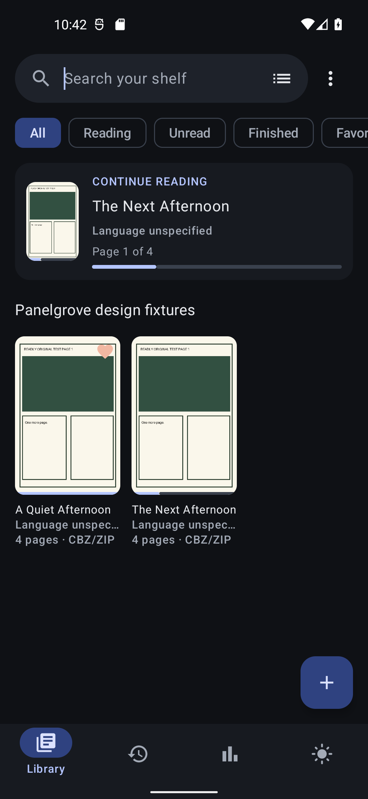](1.0/library-dark.png) | [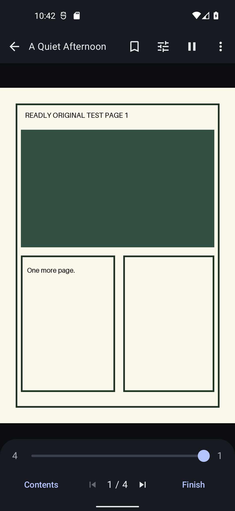](1.0/reader.png) | [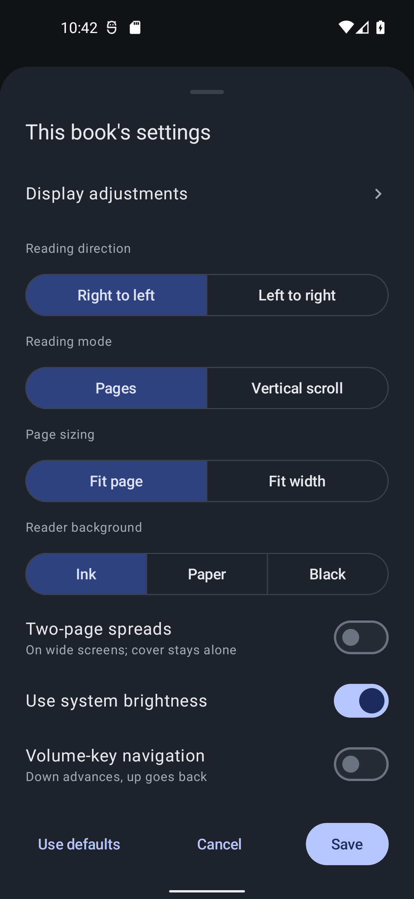](1.0/reading-settings.png) |
| **Week comparison** | **Month graph** | **Chapter/session details** |
| [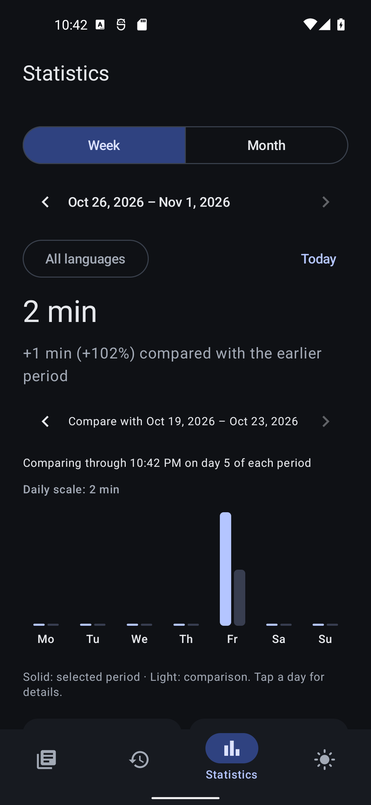](1.0/statistics-week.png) | [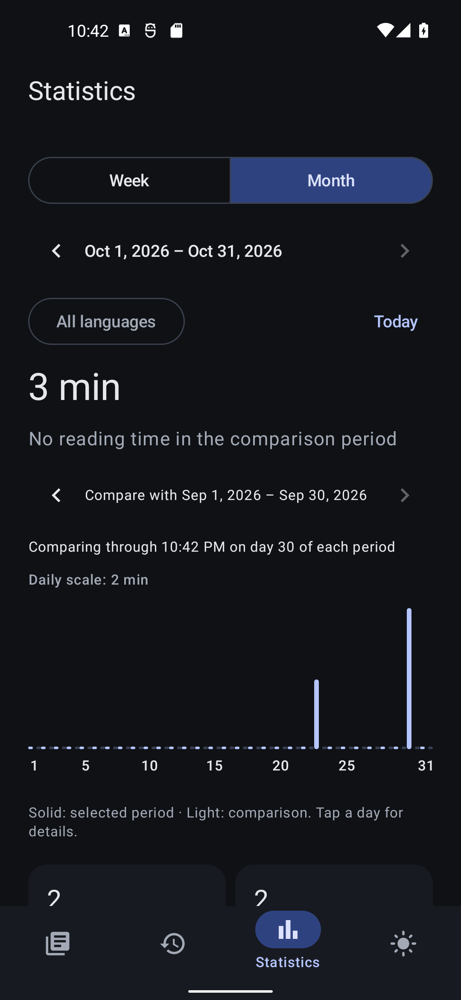](1.0/statistics-month.png) | [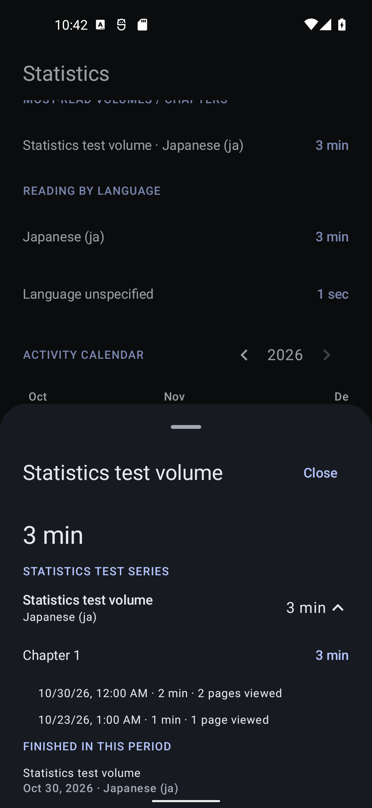](1.0/statistics-drilldown.png) |
| **Activity calendar** | **Book details** | **Bookmarks** |
| [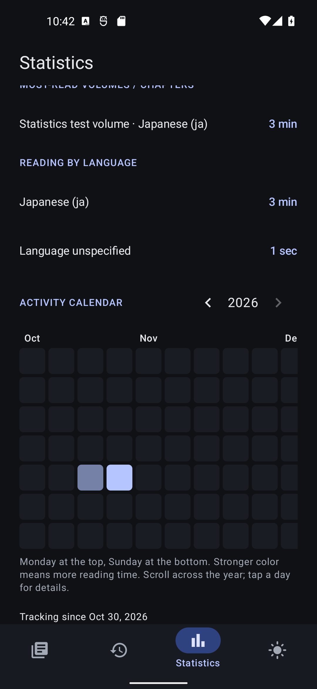](1.0/statistics-calendar.png) | [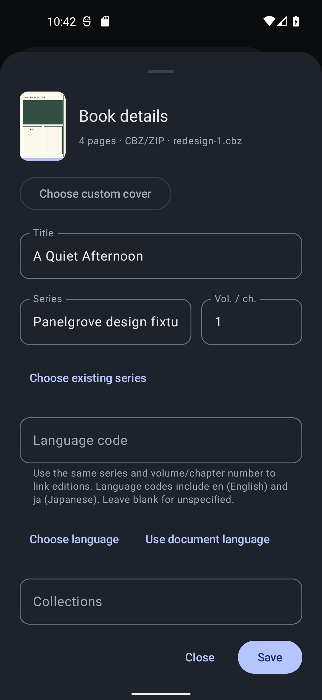](1.0/book-details.png) | [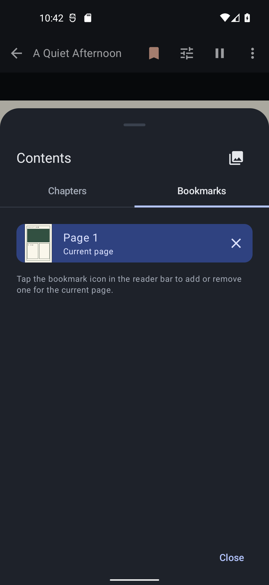](1.0/bookmarks.png) |
| **History** | **Settings** | |
| [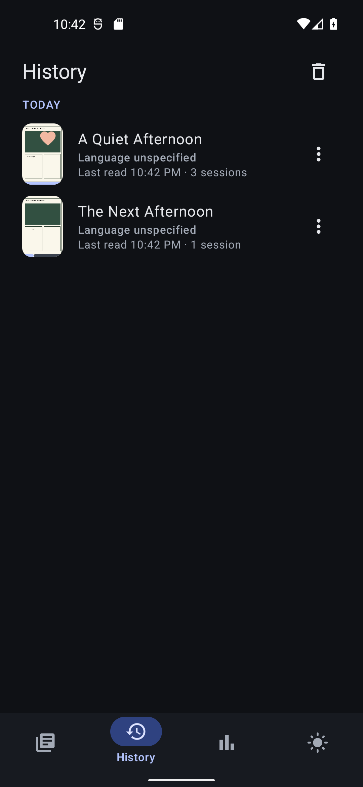](1.0/history.png) | [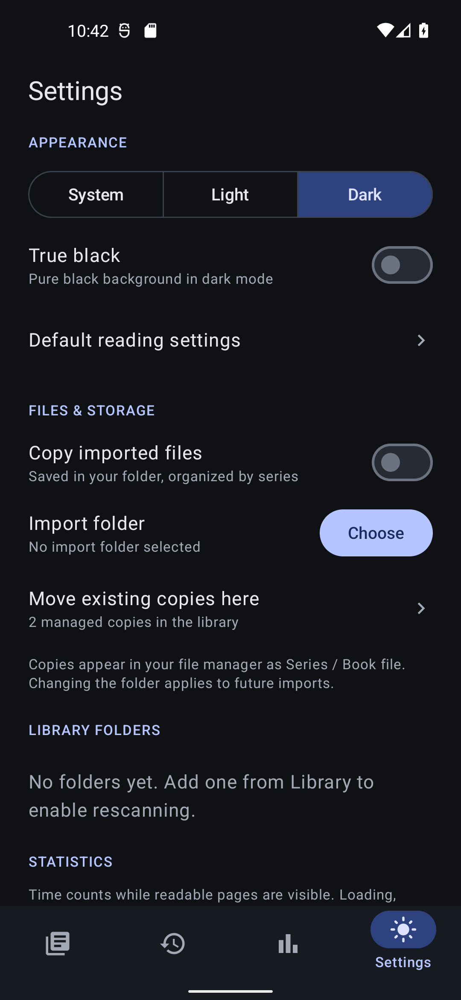](1.0/settings.png) | |

The original generated artwork is included under the project's GPL-3.0-or-later license. No private manga or personal library is used.

## Historical 0.1.6 captures

Captured from the signed **Panelgrove 0.1.6** preview on an **Android 12L / API 32** emulator on **2026-10-26**. Each image is an unedited **1080 × 2340** Android screen capture. Click an image to view it at full size.

These earlier captures retain their original build identity. They do not picture the language-edition stacks/picker, page export, custom-cover controls, contrast/gamma controls or reading statistics added later.

The books use original geometric demo artwork created for these screenshots. The artwork is included in the images under the project's GPL-3.0-or-later license. No private manga, personal library, or earlier development screenshots are used.

| Dark library | Light library |
| --- | --- |
|  | [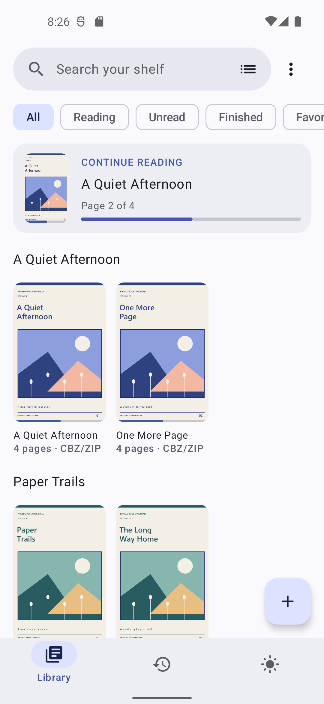](library-light.png) |
| **Reader** | **Reading settings** |
|  |  |
| **Bookmarks** | **Book details** |
|  | [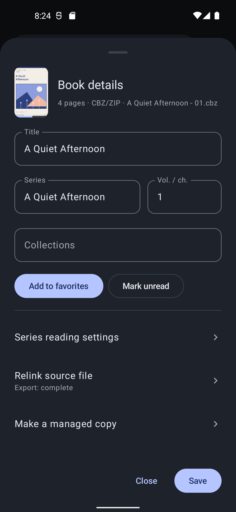](book-details.png) |
| **History** | **Settings** |
|  |  |

[Back to Panelgrove](../../README.md)
